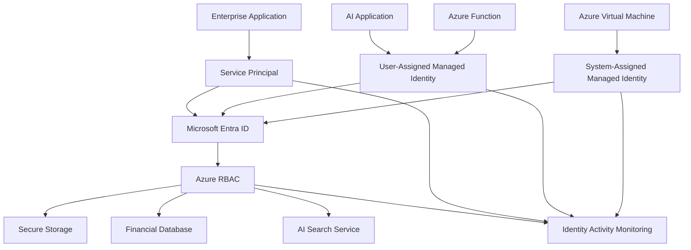

# Azure Workload Identity and RBAC Architecture

## 1. Purpose

This document defines the workload identity and Azure Role-Based Access Control architecture for BonganiSecure Financial Services.

The objective is to ensure that applications, services and cloud workloads authenticate securely and receive only the permissions required to perform their business functions.

The architecture prioritises managed identities, controlled service principals, least-privilege permissions and continuous monitoring.

## 2. Workload Identity Architecture

Azure workloads require identities to authenticate to other Azure services.

The architecture supports:

- System-assigned managed identities.
- User-assigned managed identities.
- Microsoft Entra service principals.
- Application registrations.
- Azure RBAC.
- Microsoft Entra application permissions.

These identity mechanisms have different purposes and should not be treated as interchangeable.

## 3. High-Level Architecture



This is a proposed target-state design, not a deployed enterprise workload environment.

## 4. System-Assigned Managed Identities

A system-assigned managed identity is created as part of an Azure resource's identity configuration.

Characteristics:

- Its lifecycle is linked to the Azure resource.
- It is suitable for a single workload or resource.
- Azure manages its underlying credentials.
- It can receive Azure RBAC assignments.

Example:

An Azure-hosted financial reporting application requires read access to an approved storage resource.

The application uses its system-assigned managed identity to authenticate without embedding a client secret in its configuration.

## 5. User-Assigned Managed Identities

A user-assigned managed identity is an independent Azure resource.

Characteristics:

- Its lifecycle is independent of a particular workload.
- It can be attached to multiple supported Azure resources.
- It can receive RBAC assignments independently.
- It can support identity reuse across approved workloads.

Example:

A financial data-processing service and a reporting service use a shared user-assigned identity where the business design explicitly permits that shared access.

Shared identity use must be assessed carefully because it can increase the impact of a compromised workload.

## 6. System-Assigned vs User-Assigned Identity

| Characteristic | System-Assigned | User-Assigned |
|---|---|---|
| Lifecycle | Linked to resource | Independent resource |
| Creation | Through resource configuration | Separate Azure resource |
| Workload sharing | Not designed for shared reuse | Can be attached to multiple supported resources |
| Permission management | Azure RBAC | Azure RBAC |
| Credential handling | Managed by Azure | Managed by Azure |
| Typical use | Single workload | Independently managed workload identity |

Selection should be based on lifecycle, ownership, isolation and operational requirements.

## 7. Service Principal Architecture

A service principal represents an application identity in a Microsoft Entra tenant.

Application registrations define the application's identity and configuration. Enterprise applications represent the tenant-local service principal.

Service principals may authenticate using:

- Certificates.
- Client secrets.
- Federated identity credentials, where supported.

### Security requirements

- Assign an accountable application owner.
- Prefer managed identities for supported Azure workloads.
- Prefer certificate-based or federated authentication over long-lived shared secrets where appropriate.
- Store secrets securely when their use is unavoidable.
- Rotate and revoke credentials according to policy.
- Review API permissions and consent.
- Monitor service principal sign-ins and credential changes.

## 8. Azure RBAC Scope Architecture

Azure RBAC controls access to Azure resources through role assignments.

The scope hierarchy is:

```text id="z9f4k1"
Management Group
       |
   Subscription
       |
  Resource Group
       |
    Resource
```

A role assigned at a parent scope can be inherited by resources beneath it.

### Scope selection

| Scope | Appropriate Use |
|---|---|
| Management Group | Governance across multiple subscriptions |
| Subscription | Broad subscription administration |
| Resource Group | Access to a defined workload boundary |
| Resource | Access to a specific Azure resource |

The smallest practical scope should be selected.

## 9. Role Design

| Role | Permission Model | Intended Use |
|---|---|---|
| Reader | Read resource information | Monitoring and assessment |
| Contributor | Manage resources, but cannot grant access by default | Workload operations |
| Owner | Full resource management and access administration | Restricted administration |
| User Access Administrator | Manage access assignments | Restricted identity administration |

Built-in roles should be preferred where they satisfy the requirement.

Custom roles should be introduced only where a documented permission gap exists.

## 10. Financial Services Workload Examples

### Financial reporting application

- Identity: System-assigned managed identity.
- Resource: Approved financial reporting storage.
- Role: Reader or a suitable data-plane role, depending on the service.
- Scope: Specific resource where practical.

### Risk analytics workload

- Identity: User-assigned managed identity.
- Resource: Approved risk data services.
- Role: Minimum required data access.
- Scope: Defined workload resources.

### Enterprise AI assistant

- Identity: Managed identity where supported.
- Resource: Approved AI search and application services.
- Permissions: Restricted to authorised retrieval and service operations.
- Additional control: User-level document authorisation enforced by the application.

Important: Azure management-plane Reader access does not automatically grant access to read all data stored in a resource. Data-plane permissions may require separate roles.

## 11. Privilege Escalation Risks

Potential risks include:

- Excessive Owner assignments.
- Unnecessary subscription-wide Contributor access.
- Unrestricted role assignment permissions.
- Unreviewed inherited permissions.
- Compromised service principal credentials.
- Over-privileged managed identities.

Mitigations:

1. Review all role assignments.
2. Restrict access administration.
3. Scope workload permissions appropriately.
4. Review inherited assignments.
5. Monitor roleAssignments/write and roleAssignments/delete operations.
6. Investigate unexpected identity permission changes.

## 12. Workload Identity Monitoring

Priority monitoring areas include:

- Managed identity authentication activity.
- Service principal sign-in activity.
- Credential creation and modification.
- Identity attachment and configuration changes.
- Azure RBAC role assignments.
- Unusual workload access patterns.

Azure Activity Logs and Microsoft Entra logs should be used together to investigate identity activity.

## 13. Portfolio Evidence

Project 3 provides practical evidence supporting this architecture:

- Created and inspected a user-assigned managed identity.
- Reviewed managed identity metadata.
- Investigated identity usage and attachment.
- Verified a Reader assignment at `BonganiSecurity` resource-group scope.
- Reviewed a finance service principal.
- Investigated application permissions, assignments, credentials and ownership.

Project 4 extended this work through managed identity and service principal threat investigations.

These observations do not establish that all proposed workload designs have been deployed or that workload data access has been tested.

## 14. Limitations

This document describes a proposed enterprise architecture.

It does not claim that:

- The financial reporting application exists.
- The risk analytics workload has been deployed.
- The AI assistant is connected to Azure AI Search.
- All proposed managed identity assignments exist.
- Production workload authentication has been tested.

## 15. Conclusion

Secure workload identity is essential to protecting modern Azure environments.

The architecture reduces reliance on embedded credentials, limits excessive permissions and establishes a monitoring framework for application and workload access.

It provides a foundation for secure financial-services applications and AI-enabled enterprise workloads.
