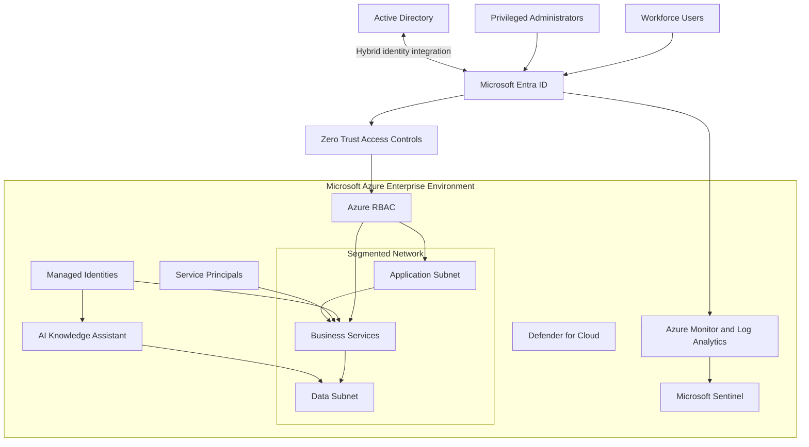

# Enterprise Azure Security Architecture

## 1. Architecture Overview

This document defines the proposed enterprise Azure cybersecurity architecture for BonganiSecure Financial Services.

The design integrates identity security, hybrid directory services, cloud infrastructure protection, workload identity, network segmentation, security monitoring and AI application security.

The architecture follows a Zero Trust model and applies defence-in-depth principles across the enterprise environment.

**Architecture status:** Proposed enterprise design. Individual components are classified according to their implementation status in the portfolio.

## 2. High-Level Architecture

The diagram represents the target architecture. The hybrid identity connection, enterprise network, AI workload, monitoring integrations and Sentinel deployment are design components, not claims of live deployment.

## 3. Identity and Access Management Layer

Microsoft Entra ID serves as the central cloud identity platform.

Core design components:

- Workforce user identities.
- Privileged administrator identities.
- Security groups.
- Authentication policies.
- Application registrations and enterprise applications.
- Service principals.
- Managed identities.
- Azure RBAC assignments.

### Identity controls

The architecture requires:

1. Strong authentication for workforce accounts.
2. Separate privileged administration accounts.
3. Least-privilege role assignments.
4. Controlled identity onboarding and offboarding.
5. Periodic application and permission reviews.
6. Monitoring of privileged identity changes.

Security Defaults are suitable for baseline protection in the current Entra Free lab. Advanced Conditional Access and Privileged Identity Management require appropriate licensing and are proposed enhancements.

## 4. Active Directory and Hybrid Identity

The target enterprise environment may use on-premises Active Directory for legacy applications and directory-dependent services.

Proposed integration:

- Active Directory Domain Services.
- Organisational units and security groups.
- Controlled administrative delegation.
- Secure authentication and directory auditing.
- Microsoft Entra Connect or Cloud Sync, selected after reviewing business requirements.
- Defined identity synchronisation and recovery procedures.

Hybrid identity integration is proposed and has not been deployed in this capstone.

## 5. Azure Workload Identity Architecture

Azure workloads should authenticate using managed identities wherever supported.

### Managed identities

Use system-assigned identities when an identity should share the lifecycle of one Azure resource.

Use user-assigned identities when an identity needs an independent lifecycle or must be shared across supported workloads.

### Service principals

Service principals should have:

- Documented business owners.
- Minimum required API permissions.
- Secure authentication credentials.
- Defined credential rotation procedures.
- Monitored authentication activity.

### Azure RBAC

RBAC assignments must be scoped to the smallest practical boundary.

The design distinguishes:

- Management group scope.
- Subscription scope.
- Resource group scope.
- Individual resource scope.

Owner and User Access Administrator permissions must be tightly controlled.

## 6. Network Security Architecture

The target network separates application, business services and data workloads.

### Application subnet

Hosts approved application-facing components.

### Business services subnet

Hosts internal application services and APIs.

### Data subnet

Hosts sensitive databases and storage services.

### Network controls

- Network Security Groups.
- Restrictive inbound and outbound rules.
- Approved application communication paths.
- Restricted management access.
- Private connectivity where appropriate.
- Network configuration monitoring.

The subnet architecture is a proposed enterprise design. The existing lab VNet and NSG provide limited practical evidence of Azure networking work, not a deployment of this full architecture.

## 7. Cloud Security Posture and Protection

Microsoft Defender for Cloud is the proposed central cloud security posture and workload protection platform.

Design objectives:

- Assess resource configurations.
- Identify security recommendations.
- Review identity-related risks.
- Monitor supported workloads.
- Track remediation and security posture improvements.

The exact Defender plans must be selected according to workload requirements, licensing and budget.

The current portfolio does not claim full Defender for Cloud enterprise protection deployment.

## 8. Security Monitoring Architecture

The proposed monitoring flow is:

1. Microsoft Entra ID produces sign-in and audit records.
2. Azure Activity Logs record Azure management operations.
3. Application and workload logs provide additional context.
4. Azure Monitor and Log Analytics provide centralised collection and analysis.
5. Microsoft Sentinel supports security analytics, correlation and incident management where deployed.

Priority detections include:

- Privileged role assignment changes.
- Suspicious sign-in activity.
- Service principal credential modifications.
- Managed identity permission changes.
- Identity lifecycle anomalies.
- Unexpected administrative operations.

The Project 4 KQL files provide starter detection logic. They have not been validated against a live Sentinel workspace.

## 9. AI Workload Security Architecture

The target AI solution is an enterprise knowledge assistant used by authorised financial-services employees.

Proposed components:

- Entra ID user authentication.
- An AI application and orchestration layer.
- Azure AI Search or an equivalent retrieval service.
- Approved enterprise document repositories.
- Managed identity authentication between supported Azure services.
- Document-level authorisation.
- Agent action policy enforcement.
- Audit logging.

### Critical AI security controls

1. Verify the user's identity before providing access.
2. Enforce document-level authorisation at retrieval time.
3. Prevent the AI application from bypassing source-system permissions.
4. Restrict agent tools and actions.
5. Protect secrets and service credentials.
6. Monitor data retrieval and application actions.
7. Test for prompt injection and unauthorised data disclosure.

The AI architecture is a proposed design. No production AI service or document repository is deployed through this capstone.

## 10. Governance and Operational Security

The enterprise security operating model includes:

- Identity governance.
- Privileged access reviews.
- Security configuration reviews.
- Vulnerability and exposure management.
- Incident response.
- Evidence preservation.
- Security reporting.
- Risk-based remediation.

Security responsibilities should be assigned across identity administration, cloud engineering, security operations and application ownership.

## 11. Architecture-to-Portfolio Evidence Mapping

| Architecture Domain | Supporting Portfolio Evidence | Status |
|---|---|---|
| Entra ID Zero Trust | Project 1 | Implemented and investigated |
| Active Directory security | Project 2 | Simulated engineering |
| Azure workload identity | Project 3 | Live investigation and configuration review |
| Azure RBAC | Project 3 | Assignment verified |
| Identity threat detection | Project 4 | Live investigation and detection templates |
| Enterprise network segmentation | Project 3 and design | Partial lab evidence and proposed design |
| Defender for Cloud | Earlier Azure lab observations | Limited configuration evidence |
| Microsoft Sentinel | Project 4 | Proposed integration |
| AI workload security | AI security portfolio work and design | Design and simulation |

## 12. Architecture Limitations

This architecture is a target-state enterprise design, not a production deployment.

It does not claim that:

- A hybrid Active Directory environment is deployed.
- All proposed network segments exist.
- Microsoft Sentinel is operational.
- All Defender plans are enabled.
- Advanced Entra licensing capabilities are available.
- The proposed AI knowledge assistant is deployed.

Implementation status will be updated only when evidence supports the change.

## 13. Conclusion

The proposed architecture provides an integrated security model for a modern financial-services organisation.

It places identity at the centre of cloud security, combines least-privilege workload access with network segmentation, and establishes monitoring and incident response as continuous operational capabilities.

It also extends Zero Trust principles to AI applications and agent-based workflows, addressing the security challenges of modern enterprise technology.
