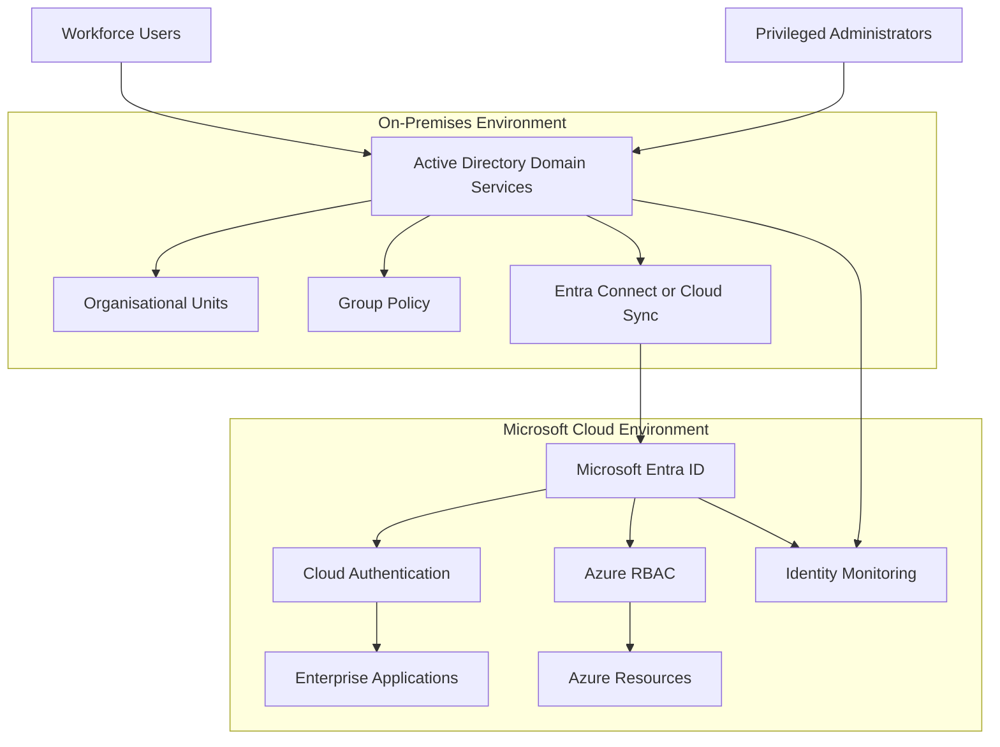

# Hybrid Active Directory and Microsoft Entra ID Architecture

## 1. Purpose

This document defines the proposed hybrid identity architecture for BonganiSecure Financial Services.

The design integrates traditional on-premises Active Directory Domain Services (AD DS) with Microsoft Entra ID to support enterprise authentication, cloud application access and centralised identity governance.

The objective is to maintain secure identity management across legacy infrastructure and modern cloud services.

**Implementation status:** Architecture design and simulation. No live Active Directory domain or hybrid synchronisation service has been deployed in this capstone.

## 2. Business Context

The organisation operates a combination of:

- Legacy business applications.
- Windows-based enterprise systems.
- Cloud-hosted applications.
- Microsoft 365 and Azure services.
- Financial and risk management systems.
- AI-enabled business applications.

Some applications may depend on traditional Active Directory authentication, while newer applications use Microsoft Entra ID.

A hybrid identity architecture provides a controlled approach to managing both environments.

## 3. High-Level Architecture



This diagram represents a target-state design. It does not indicate that synchronisation or hybrid authentication has been configured.

## 4. Active Directory Domain Architecture

The proposed domain is:

`corp.bonganisecure.local`

Proposed domain controller:

`BS-DC01`

These are design names only and have not been deployed.

### Organisational unit structure

```text
corp.bonganisecure.local
|
+-- BonganiSecure
    |
    +-- Users
    |   +-- Finance
    |   +-- Risk
    |   +-- Compliance
    |   +-- IT
    |   +-- Operations
    |
    +-- Groups
    |   +-- Finance-Groups
    |   +-- Risk-Groups
    |   +-- IT-Groups
    |   +-- Privileged-Groups
    |
    +-- Servers
    |   +-- Application-Servers
    |   +-- Database-Servers
    |
    +-- Workstations
    |
    +-- Service-Accounts
```

The OU structure separates business functions and infrastructure responsibilities.

## 5. Identity Synchronisation

Microsoft Entra Connect Sync or Microsoft Entra Cloud Sync may be selected to synchronise identities between Active Directory and Microsoft Entra ID.

The selection must consider:

- Directory size and complexity.
- Existing authentication infrastructure.
- Network connectivity.
- High availability requirements.
- Password and authentication requirements.
- Operational support capabilities.

### Synchronisation security requirements

1. Restrict synchronisation administration.
2. Protect synchronisation service accounts.
3. Monitor synchronisation configuration changes.
4. Review synchronised identities and attributes.
5. Protect the synchronisation infrastructure.
6. Document recovery procedures.

Synchronisation must not be treated as a substitute for access governance.

## 6. Hybrid Authentication Options

The architecture considers three authentication approaches.

| Approach | Description | Considerations |
|---|---|---|
| Password Hash Synchronisation | Synchronises a derived representation of the on-premises password hash to Entra ID | Simplifies cloud authentication resilience |
| Pass-through Authentication | Validates authentication against on-premises AD through authentication agents | Requires available and maintained infrastructure |
| Federation | Uses an external federation service such as AD FS | Adds infrastructure and operational complexity |

The final approach must be selected through a security and operational assessment.

Password Hash Synchronisation can also provide cloud authentication resilience when used alongside other supported authentication configurations.

## 7. Privileged Identity Separation

The architecture separates administrative responsibilities across the hybrid environment.

### Active Directory administration

Responsibilities include:

- Domain administration.
- Organisational unit management.
- Group membership administration.
- Group Policy management.
- Domain controller security.

### Microsoft Entra administration

Responsibilities include:

- Cloud identity administration.
- Enterprise application management.
- Authentication policy administration.
- Cloud role assignments.
- Identity governance.

### Security requirements

- Use separate privileged accounts.
- Minimise standing administrative privileges.
- Restrict Domain Admin membership.
- Monitor privileged group changes.
- Protect domain controllers.
- Review cloud and on-premises administrative role assignments independently.

## 8. Group and Access Management

The architecture uses role-oriented security groups.

Examples:

| Security Group | Intended Access |
|---|---|
| SG-Finance-Users | Approved finance resources |
| SG-Risk-Users | Risk management resources |
| SG-Compliance-Users | Compliance resources |
| SG-IT-Administrators | Approved IT administration |
| SG-Server-Administrators | Approved server administration |

Group membership must be based on documented business requirements.

High-privilege groups require restricted membership and monitoring.

## 9. Directory Security Controls

The proposed Active Directory security baseline includes:

- Strong password and authentication policies.
- Account lockout controls.
- Secure Kerberos configuration.
- LDAP signing and channel binding where supported.
- Protected domain administrator accounts.
- Controlled delegation.
- Group Policy security baselines.
- Directory audit logging.
- Secure domain controller administration.

Configuration choices must be tested against application compatibility and operational requirements.

## 10. Hybrid Identity Threat Scenarios

### Synchronisation account compromise

An attacker compromises a synchronisation identity and attempts to manipulate synchronised directory information.

**Mitigations:** Restrict privileges, monitor account activity, protect credentials and review synchronisation changes.

### Privileged group manipulation

An attacker adds an unauthorised identity to a high-privilege Active Directory group.

**Mitigations:** Monitor group membership changes, restrict delegation and investigate privileged membership modifications.

### Domain controller compromise

An attacker gains control of a domain controller and attempts to compromise enterprise identities.

**Mitigations:** Harden domain controllers, restrict administrative access, monitor authentication activity and maintain tested recovery procedures.

### Hybrid identity takeover

An attacker compromises an on-premises identity that is synchronised to the cloud.

**Mitigations:** Secure both identity environments, investigate correlated activity and establish clear containment procedures.

## 11. Monitoring and Incident Response

Monitoring should include:

- Active Directory authentication events.
- Privileged group membership changes.
- Account creation and deletion.
- Group Policy changes.
- Synchronisation service activity.
- Microsoft Entra sign-in logs.
- Microsoft Entra audit logs.
- Azure administrative activity.

Where deployed, centralised monitoring can correlate on-premises and cloud identity events.

## 12. Recovery and Resilience

The architecture requires:

- Protected directory backups.
- Tested Active Directory recovery procedures.
- Documented domain controller recovery.
- Synchronisation service recovery plans.
- Emergency administrative access procedures.
- Cloud identity recovery processes.

Recovery arrangements must prevent compromised identities from being restored without appropriate security validation.

## 13. Portfolio Evidence and Limitations

This design draws on Project 2, which includes simulated Active Directory domain design, OU planning, security group reviews, privileged access assessments, authentication security and incident investigation.

The proposed hybrid integration has not been deployed.

No live domain controller, Entra Connect service, Cloud Sync configuration or hybrid authentication flow is claimed.

## 14. Conclusion

The hybrid identity architecture provides a structured approach to connecting traditional Active Directory services with Microsoft Entra ID.

It establishes clear administrative boundaries, controlled identity synchronisation, secure authentication and monitoring across both environments.

This design supports the organisation's broader Zero Trust and Azure cybersecurity objectives.
