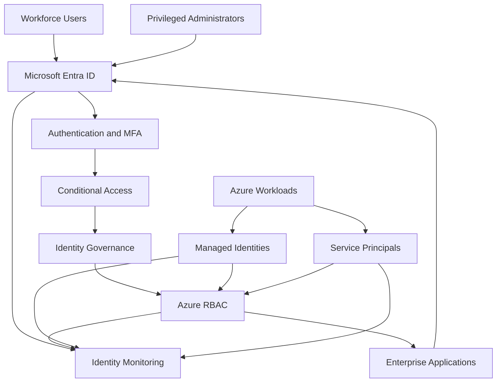

# Zero Trust Identity Architecture

## 1. Purpose

This document defines the Zero Trust identity architecture for BonganiSecure Financial Services.

The architecture establishes identity as the primary security boundary for workforce users, privileged administrators, enterprise applications and Azure workloads.

It applies the principles of explicit verification, least-privilege access and continuous evaluation.

## 2. Zero Trust Principles

The architecture is based on three core principles:

1. **Verify explicitly:** Authenticate and evaluate access using available identity, authentication, device and contextual signals.
2. **Use least privilege:** Grant only the permissions required to perform an authorised business function.
3. **Assume breach:** Design monitoring, segmentation and response capabilities on the assumption that an identity or workload may become compromised.

## 3. Identity Architecture

This is a proposed logical architecture. Advanced Conditional Access and governance capabilities depend on licensing and deployment.

## 4. Workforce Identity Security

Every workforce identity must have a defined business purpose and accountable owner.

Required controls:

- Unique user identities.
- Strong authentication.
- MFA enforcement.
- Role-based access.
- Group-based access design where supported.
- Periodic access reviews.
- Immediate offboarding when employment or access requirements end.

### Identity lifecycle

**Joiner**
- Create the identity.
- Verify the business owner and employment status.
- Assign approved groups and application access.
- Apply authentication requirements.

**Mover**
- Review previous permissions.
- Remove access no longer required.
- Assign permissions appropriate to the new role.
- Record and approve material changes.

**Leaver**
- Disable the identity.
- Revoke active sessions where appropriate.
- Remove application assignments and group membership.
- Review privileged permissions.
- Preserve required audit evidence.

## 5. Authentication Architecture

Microsoft Entra ID provides the central authentication platform.

The proposed authentication controls include:

- Microsoft Authenticator or another approved strong authentication method.
- MFA requirements for workforce access.
- Phishing-resistant authentication for privileged roles where supported.
- Authentication method governance.
- Monitoring of authentication failures and unusual sign-in activity.

The existing Entra Free lab demonstrated Security Defaults and Microsoft Authenticator configuration. Advanced authentication policies require separate licensing and capability assessment.

## 6. Conditional Access Design

Conditional Access should evaluate relevant signals before granting access.

Potential signals include:

- User identity.
- Group membership.
- Application being accessed.
- Device compliance.
- Network location.
- Sign-in risk.
- Authentication strength.

Example policy design:

| Policy | Intended Control |
|---|---|
| Workforce MFA | Require MFA for workforce access |
| Administrator protection | Apply stronger authentication to privileged users |
| Untrusted device access | Restrict access from devices that fail defined requirements |
| High-risk sign-ins | Apply appropriate risk-based response |
| Legacy authentication | Block unsupported legacy authentication protocols |

These are proposed policies. They are not claimed as deployed in the existing Entra Free tenant.

## 7. Privileged Access Architecture

Administrative privileges require stronger governance than standard workforce access.

The design separates:

- Global administration.
- Identity administration.
- Security administration.
- Azure subscription administration.
- Application administration.
- Workload operations.

Controls include:

- Separate privileged accounts.
- Least-privilege administrative roles.
- Limited role assignment permissions.
- Documented approval processes.
- Privileged activity monitoring.
- Periodic privileged access reviews.

Microsoft Entra Privileged Identity Management should be considered where the appropriate licensing is available.

## 8. Azure RBAC Architecture

Azure RBAC controls access to Azure resources.

The architecture applies permissions according to the operational responsibilities of each identity.

| Role | Intended Purpose |
|---|---|
| Reader | View resources without modifying them |
| Contributor | Manage resources without granting access by default |
| Owner | Manage resources and access permissions |
| Security Reader | View security-related information where appropriate |

### Scope hierarchy

1. Management group.
2. Subscription.
3. Resource group.
4. Individual resource.

Permissions should be assigned at the lowest practical scope.

A workload that needs access to one resource should not automatically receive subscription-wide permissions.

## 9. Workload Identity Architecture

### Managed identities

Managed identities are preferred for supported Azure-to-Azure authentication scenarios because they avoid storing application credentials in the workload.

### Service principals

Service principals are used for application identities where required.

Controls include:

- Defined application ownership.
- Minimum permissions.
- Secure credential management.
- Credential rotation.
- Authentication monitoring.
- Periodic access reviews.

## 10. Application Access Governance

Enterprise applications must have:

- A documented business purpose.
- An accountable application owner.
- Approved permissions.
- Defined assignment requirements.
- Controlled authentication mechanisms.
- Periodic permission reviews.

Applications with no confirmed business purpose should be investigated before access is removed or the application is disabled.

## 11. Identity Monitoring

The security operations function should monitor:

- Successful and failed sign-ins.
- Authentication anomalies.
- Privileged role assignments.
- Application permission changes.
- Service principal credential modifications.
- Managed identity configuration changes.
- User and group lifecycle operations.

Azure Activity Logs and Microsoft Entra logs provide important investigation evidence.

Centralised monitoring using Log Analytics and Microsoft Sentinel is a proposed enhancement, subject to deployment and licensing.

## 12. Enforcement and Governance Model

The architecture uses a layered enforcement model:

| Layer | Security Responsibility |
|---|---|
| Identity | Authenticate users and applications |
| Authentication | Verify identity and authentication strength |
| Access policy | Evaluate access conditions |
| Authorisation | Enforce approved permissions |
| Workload identity | Secure application-to-service access |
| Monitoring | Record and analyse activity |
| Governance | Review permissions and ownership |
| Incident response | Investigate and contain compromise |

## 13. Portfolio Evidence

This architecture draws on:

- Project 1: Entra ID authentication, identity lifecycle and application access.
- Project 3: Managed identity and Azure RBAC scope verification.
- Project 4: Sign-in investigation, privileged role monitoring and workload identity threat detection.

The evidence is based on the documented lab findings. Proposed enterprise controls remain design recommendations.

## 14. Conclusion

The Zero Trust identity architecture provides a consistent security model for workforce users, administrators, applications and Azure workloads.

It reduces excessive permissions, strengthens authentication, improves identity accountability and provides a foundation for continuous identity security monitoring.
